# Data Engineering & Ingestion Pipeline Architecture

This document describes the data engineering, document ingestion, validation, and storage pipelines in **BAYYAN AI (بيان)**. The backend separates **unstructured legal knowledge ingestion** (ChromaDB + BM25 hybrid retrieval) from **transactional taxpayer document processing and deterministic financial calculation** (MinIO + PostgreSQL 17 + fixed-point `Decimal` arithmetic).

---

## 1. End-to-End Pipeline Architecture

```mermaid
flowchart TD
    subgraph RAG["1. Knowledge-Base Ingestion & Hybrid RAG Pipeline"]
        Staging["Staged Candidates\n(knowledge_base/staging/*.source.json)"] -->|validate_knowledge_candidates.py\nSHA-256, bytes, HTTPS .gov.jo, ISO dates| Gate{"Promotion Gate\n(Manual Review)"}
        Manifest["Active Manifest\n(knowledge_base/manifest.json)"] --> Ingest["ingest_knowledge_base.py\n(run_ingestion)"]
        Gate -.->|Explicit promotion only| Manifest
        Ingest -->|MD / TXT / PDF + OCR fallback| Chunker["Legal & Guidance Chunkers\n(المادة / الفصل / clause splitting)"]
        Chunker -->|validate_chunk + intra-file dedup| Hash["SHA-256 Content Hash\n(file bytes + chunk texts)"]
        Hash -->|Skip if active hash matches| Chroma[("ChromaDB Vector Store\ntax_law_jordan_v2_<digest>\n1024-dim Multilingual E5")]
        Chroma -->|Active & status in demo/reviewed| Hybrid["Hybrid Retriever\n60% Cosine + 40% BM25Okapi"]
    end

    subgraph DOC["2. Invoice Extraction & Transactional Persistence Pipeline"]
        Upload["Taxpayer Upload\n(PNG / JPEG / PDF / WEBP)"] -->|Magic-byte & 10 MB check| MinIO[("MinIO Object Storage\n(S3-Compatible)")]
        MinIO --> Quota["Idempotent Usage Reservation\n(usage_reservations table)"]
        Quota --> Primary["Tier 1: Gemini Vision\n(gemini-2.5-flash)"]
        Primary -->|Error or confidence < 0.65| Fallback["Tier 2: Claude Vision\n(claude-sonnet-4-20250514)"]
        Primary -->|confidence >= 0.65| Parse["JSON Sanitizer & Field Validator\n(parsing.py / validate_extraction_fields)"]
        Fallback --> Parse
        Parse -->|SELECT ... FOR UPDATE\nawaiting_confirmation = true| DocTable[("PostgreSQL: documents\n(extracted_data JSONB)")]
        DocTable -->|Human-in-the-loop review\nIf-Match profile version| DedTable[("PostgreSQL: deductions\nNumeric(15,3) fils + uq_document_id")]
        DedTable --> CalcEngine["Deterministic Tax Engine\n(Immutable calculation_runs snapshot)"]
    end
```



---

## 2. Knowledge-Base Ingestion Pipeline (`backend/scripts/ingest_knowledge_base.py`)

### Source Governance & Staging Isolation
- **Manifest-Driven Ingestion:** Only files explicitly listed in [`backend/knowledge_base/manifest.json`](../backend/knowledge_base/manifest.json) (`schema_version: 1`) are read by the ingestion runner. Path traversal outside `knowledge_base/` and duplicate entries are rejected.
- **Candidate Validation Gate:** Unreviewed candidate files reside in `backend/knowledge_base/staging/` alongside `*.source.json` metadata records. [`backend/scripts/validate_knowledge_candidates.py`](../backend/scripts/validate_knowledge_candidates.py) verifies SHA-256 digests, exact byte lengths, ISO date fields, and `.gov.jo` HTTPS origins before any source can be considered for promotion.
- **Offline Isolation Audit:** [`backend/scripts/evaluate_rag_offline.py`](../backend/scripts/evaluate_rag_offline.py) verifies that `0` staged `needs_review` records leak into `manifest.json`.

### Multi-Format Text Extraction & Legal-Structure Chunking
1. **Text & Scanned PDF Extraction:** `.md` and `.txt` sources are read as UTF-8. `.pdf` files are extracted page-by-page using `pdfplumber`; any page yielding fewer than `50` characters is automatically rendered at `200 DPI` via `pypdfium2` and passed to `pytesseract` (`lang="ara+eng"` with English fallback), preserving 1-based page numbers for citations.
2. **Structure-Aware Chunking ([`backend/app/rag/chunker.py`](../backend/app/rag/chunker.py)):**
   - **Legal sources (`chunk_legal_document`):** Splits text along Arabic and English statutory boundaries — chapter (`الفصل`), article (`المادة` / `Article`), and clause (`(أ)`, `(ب)`, `(1)`) — attaching citation metadata (`article_number`, `chapter`, `clause`, `law_year`, `effective_date`, `page_number`) and bilingual tax keywords.
   - **Guidance & commentary (`chunk_guidance_document`):** Splits by markdown headings and paragraph blocks (`80` to `1,200` characters).

### Chunk Quality Validation & Idempotent Upsert
- **Pre-Index Validation (`validate_chunk`):** Each generated `LegalChunk` is checked before embedding:
  - `missing_source_file`: non-empty relative path required.
  - `empty_or_short_text`: stripped chunk text must be at least `80` characters.
  - `invalid_source_type`: must belong to `SourceType` (`law`, `guidance`, `expert_commentary`).
  - `invalid_law_year`: when present, integer in `1900..2100`.
  - `invalid_effective_date`: when present, valid ISO-8601 date (`YYYY-MM-DD`).
  - `invalid_page_number`: when present, positive integer (`>= 1`).
- **Intra-Source Deduplication:** `_filter_and_deduplicate_chunks()` removes exact duplicate chunk bodies within a source file prior to embedding.
- **Content-Hash Idempotency & Reversible Revisions ([`backend/app/rag/vector_store.py`](../backend/app/rag/vector_store.py)):**
  - Each source revision is fingerprinted via `source_hash = sha256(file_bytes + joined_chunk_texts)` and each chunk receives a deterministic ID `sha256(source_file + source_hash + index + text)`.
  - If the active chunk IDs and manifest metadata (`source_title`, `source_status`, `source_url`) already match in ChromaDB, `upsert_source()` performs **zero writes** and `run_ingestion()` logs and records the file as `skipped_unchanged`.
  - When content changes, new chunks are embedded with `intfloat/multilingual-e5-large` (`1024` dimensions) and upserted with `active: True`, while prior chunks for that `source_file` are marked `active: False` so revisions can be rolled back via `activate_source_revision()` without re-embedding.
  - Collection names include a 12-character SHA-256 digest of `(schema_version, embedding_model, embedding_revision, embedding_dimension)` (`tax_law_jordan_v2_<digest>`), preventing silent vector-space corruption across model upgrades.

---

## 3. Invoice Extraction & Validation Pipeline (`backend/app/extraction/`)

### Pre-Flight Validation & Quota Idempotency
1. **Binary Signature Verification ([`backend/app/services/file_validation.py`](../backend/app/services/file_validation.py)):** Uploaded and stored documents (`PNG`, `JPEG`, `PDF`, `WEBP`, up to `10 MB`) are checked against magic-byte file signatures before any external vision API call is made.
2. **Idempotent Quota Reservations ([`backend/app/auth/usage.py`](../backend/app/auth/usage.py)):** Document extraction reserves quota in PostgreSQL (`usage_reservations` table with unique constraint `(user_id, operation, idempotency_key)`) and settles the reservation in a `finally` block.

### Two-Tier Vision Extraction & Field Validation
1. **Primary / Fallback Orchestration ([`backend/app/extraction/pipeline.py`](../backend/app/extraction/pipeline.py)):**
   - **Tier 1 (Primary):** `GeminiExtractor` (`gemini-2.5-flash`) extracts structured JSON fields (`vendor`, `amount`, `date`, `category`, `document_type`, `confidence`, `raw_text`).
   - **Tier 2 (Fallback):** Automatically escalates to `ClaudeExtractor` (`claude-sonnet-4-20250514`) when the primary extractor returns an error or `confidence < 0.65` (`EXTRACTION_CONFIDENCE_THRESHOLD`).
2. **Sanitization & Data Quality Checks ([`backend/app/extraction/parsing.py`](../backend/app/extraction/parsing.py)):**
   - Strips markdown code fences and trailing commas from LLM output.
   - Normalizes vendor strings (trimming whitespace and converting blank strings to `None`).
   - Rejects negative, boolean, `NaN`, or `Infinity` amounts (`amount` must be finite and `>= 0`).
   - Rejects malformed dates or dates outside `1990..(current_year + 1)`.
   - Clamps confidence scores to `[0.0, 1.0]`.
   - `validate_extraction_fields(result)` returns structured check flags (`extractor_error`, `missing_or_non_positive_amount`, `unknown_category`, `unknown_document_type`, `missing_vendor`, `missing_or_out_of_range_date`, `low_confidence`).

### Transactional Write Boundaries & Financial Precision
- **Row-Locked Proposal State ([`backend/app/api/document_processing.py`](../backend/app/api/document_processing.py)):** Vision extraction runs outside the DB transaction lock; once complete, the `Document` row is locked with `SELECT ... FOR UPDATE` and updated with `extracted_data` (`JSONB`), `needs_review` (`confidence < 0.85`), and `awaiting_confirmation`.
- **Human-in-the-Loop Confirmation:** Extraction never mutates tax deductions directly. When the taxpayer confirms an extracted expense, a `Deduction` record is created with:
  - Fixed-point Jordanian Dinar precision (`Numeric(15, 3)` down to `0.001` JOD / 1 fil via [`backend/app/domain/money.py`](../backend/app/domain/money.py), rejecting IEEE-754 floats).
  - Database-enforced 1-to-1 document linking (`uq_deductions_document_id`).
  - Optimistic concurrency control on `tax_profiles.version` (`If-Match` header, returning `HTTP 409` on stale writes).

---

## 4. Storage Layers Overview

| Store | Component / Table | Key Columns / Metadata | Consistency & Idempotency Mechanism |
|---|---|---|---|
| **ChromaDB** | `tax_law_jordan_v2_<digest>` | `source_file`, `source_hash`, `source_status`, `active`, `article_number`, `page_number` | Content-hash deduplication (`upsert_source`), soft-retired revisions (`active: False`), collection manifest digest check |
| **MinIO (S3)** | Document & avatar buckets | `{user_id}/{uuid}_{filename}` | Magic-byte signature validation (`PNG`, `JPEG`, `PDF`, `WEBP`) and `10 MB` cap prior to storage/extraction |
| **PostgreSQL 17** | `documents` | `id`, `user_id`, `file_path`, `document_type`, `processing_status`, `extracted_data` (`JSONB`) | Row-level `SELECT ... FOR UPDATE` during extraction write; preserves linked deduction on retry |
| **PostgreSQL 17** | `deductions` & `income_sources` | `id`, `tax_profile_id`, `category`/`type`, `amount` (`Numeric(15,3)`), `document_id` | `uq_deductions_document_id` prevents duplicate receipt claims; `parse_money()` enforces 3-decimal fils precision |
| **PostgreSQL 17** | `tax_profiles` & `calculation_runs` | `version`, `ruleset_id`, `input_fingerprint` (`SHA-256`), `input_snapshot` (`JSONB`), `output_snapshot` (`JSONB`) | Optimistic locking (`version`) + immutable calculation audit trail with canonical JSON SHA-256 fingerprint |
| **PostgreSQL 17** | `monthly_usage` & `usage_reservations` | `user_id`, `usage_month`, `operation`, `idempotency_key`, `status` | `uq_usage_reservation_key` ensures retried extraction/chat requests do not double-count monthly tier quotas |

---

## 5. Running & Inspecting the Pipelines

```bash
cd backend

# 1. Run knowledge-base ingestion and emit a JSON pipeline report
uv run python scripts/ingest_knowledge_base.py --report-json ../scratch/ingestion_report.json

# 2. Validate staged candidate metadata records (offline, no Chroma writes)
uv run python scripts/validate_knowledge_candidates.py

# 3. Run the offline RAG lexical & staging-isolation evaluation harness
uv run python scripts/evaluate_rag_offline.py

# 4. Run extraction, chunk validation, and retrieval index unit tests
uv run --frozen pytest -q tests/test_extraction.py tests/test_s13_retrieval_index.py tests/test_rag_eval_offline.py
```

Example output from `run_ingestion()` on the bundled demo manifest (`2` sources, `5` validated chunks; `0` writes on rerun):

```json
{
  "manifest_sources_total": 2,
  "files_processed": 2,
  "files_upserted": 2,
  "files_skipped_unchanged": 0,
  "chunks_generated": 5,
  "chunks_valid": 5,
  "chunks_rejected_validation": 0,
  "chunks_deduplicated_within_source": 0,
  "chunks_upserted": 5,
  "collection_total_chunks": 5
}
```
